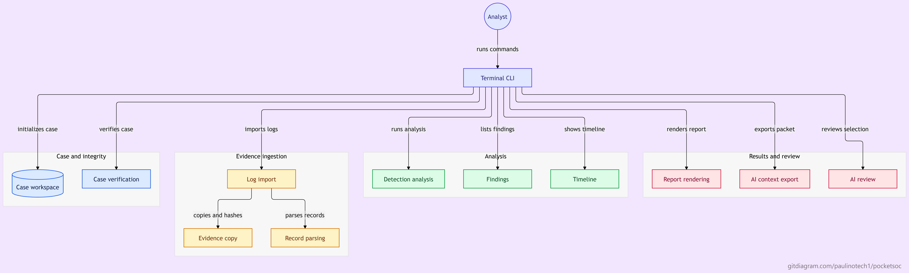

# PocketSOC

Offline security-log evidence analysis for a Debian ARM64 VM on Android. The terminal CLI is the supported interface; no graphical desktop, Tk, web server or network connection is required. Verified with Rust 1.85.1: 45 default workspace/all-target tests and eight Python SQL checks pass. See the development log for scoped validation history.

## Architecture



## Build from source

Requires Rust/Cargo 1.85 or newer, a C compiler for bundled SQLite, and trusted
cached or vendored Cargo dependencies. Python 3 is needed only for the optional
validation and benchmark scripts. Build and run from the repository root:

```sh
cargo build --locked --offline --release --bin pocketsoc
./target/release/pocketsoc --help
./target/release/pocketsoc init
./target/release/pocketsoc verify
```

A fresh clone does not contain compiled binaries, Cargo's dependency cache or an
initialized case. Arrange trusted build inputs before the offline build; runtime
never downloads dependencies. The optional ARM experiment is disabled by default.
This source snapshot is not a signed or dependency-audited release.

## Documentation

- [Architecture and field mapping](docs/architecture.md)
- [Threat model and security limits](docs/threat-model.md)
- [Security review and remaining checks](docs/security-review.md)
- [Pixel/Debian hardware observations](docs/hardware-report.md)
- [Measured performance and limits](docs/performance.md)
- [Optional advisory protocol](docs/ai-investigation.md)
- [Delimiter experiment](docs/delimiter-kernel.md)
- [Development history](docs/development-log.md) and [decisions](docs/lessons-learned.md)

## Current Pixel installation

The release executable is available as `pocketsoc` in `~/.local/bin`.
An empty private case is initialized in the project folder. From your terminal:

```sh
cd /home/droid/projects/pocketsoc
pocketsoc verify
pocketsoc --help
```

Import a real JSONL or CSV file by replacing `/path/to/logs.jsonl` below:

```sh
pocketsoc ingest /path/to/logs.jsonl
pocketsoc analyze
pocketsoc findings
pocketsoc report --format text
```

Commands print results and exit; no background service is needed. The default case
is `.pocketsoc` under your current directory. Run from the project folder to use
the initialized case, or pass `--workspace /absolute/case/path` before the command.
Synthetic validation uses a separate temporary case; no sample findings are added
to the working case. This app analyzes files you explicitly import; it does not
collect Android-private logs or scan the phone automatically.

## Commands

With the installed toolchain and cached dependencies:

```sh
cargo build --offline
cargo test --offline --workspace --all-targets
cargo clippy --offline --all-targets -- -D warnings
cargo run --offline -- --help
cargo run --offline -- doctor
cargo run --offline -- --workspace .pocketsoc init
cargo run --offline -- --workspace .pocketsoc ingest auth.jsonl
cargo run --offline -- --workspace .pocketsoc verify
cargo run --offline -- --workspace .pocketsoc analyze --failure-threshold 5 --window-seconds 300
cargo run --offline -- --workspace .pocketsoc findings
cargo run --offline -- --workspace .pocketsoc timeline --gap-seconds 3600 --skew-seconds 5
cargo run --offline -- --workspace .pocketsoc report --format html > case.html
```

Cargo.lock and cached crates are now present, and Rust 1.85.1 successfully builds and tests the project. A fresh installation needs trusted downloaded or vendored build inputs; the cache is local to this device. Bundled SQLite builds with a C compiler. Build dependencies are not runtime cloud dependencies. The optional `cargo fmt` and `cargo clippy` commands require separately installed tools.

`--workspace DIR` must precede the command. Initialization creates private directories and a local version-1 database. Existing workspaces must be private and owned by the current user. An initialized workspace is required before ingestion.

Ingestion supports UTF-8 JSONL objects and CSV with a unique, nonempty header, LF or CRLF endings, strict quote placement, and quoted multiline fields. Blank records and malformed records reject the entire import. Limits are configurable using `--max-file-bytes`, `--max-record-bytes` and `--max-records`. Defaults: 256 MiB, 1 MiB and 1,000,000 records. Record size hard ceiling: 16 MiB. Records hard ceiling: 10,000,000. Files are copied byte-for-byte, SHA-256 hashed, made owner-read-only, then parsed from the copy. Sources are never executed or written.

Canonical field mapping and detection assumptions are in [architecture](docs/architecture.md). Reports support `json`, `html` and `text`; stdout may contain a partial report if interrupted or a later integrity/I/O error occurs. Check the exit status before retaining or sharing an output. Reports are neither signed nor encrypted.

Project decisions, reasoning and tradeoffs are maintained in [lessons learned](docs/lessons-learned.md), with updates required by AGENTS.md.

See [hardware assessment](docs/hardware-report.md), [threat model](docs/threat-model.md), [security review](docs/security-review.md), and [development log](docs/development-log.md). Run `python3 tools/check_sql.py` for the narrow SQL checks that work without Rust.

Reproduce the measured offline CLI workflow with `python3 tools/measure_workflow.py --output workflow-resources.json` after a release build. It requires Python 3.11+ and GNU time, validates all three report formats, and records per-command time and peak RSS. See [synthetic resource measurements](docs/performance.md) for results and limits.

Security limits also include 4,096 CSV fields per logical record, 65,536 JSON structural tokens outside strings, a 64 MiB canonical record ceiling, and cumulative canonical payloads limited to eight times source bytes or 512 MiB, whichever is smaller. Oversized inputs fail atomically. SQL operations share a cumulative one-billion-VM-instruction / 60-second cooperative budget; this is not a hard process deadline. Reports and CLI stdout are limited to 256 MiB and may be partial on failure. Older schema-v1 workspaces receive additive correlation indexes when opened.


For the repeated 10,000 / 100,000 / 1,000,000-event phase and production-workflow suite:

```sh
cargo build --offline --release --examples --bin pocketsoc
python3 tools/benchmark.py --output docs/diagnostics/benchmark-new.json
python3 tools/report_benchmarks.py docs/diagnostics/benchmark-new.json --output docs/performance.md
```

The suite records real limit failures without weakening CLI limits. Three repetitions produce median and nearest-rank p90 results; raw measurements include compiler, CPU features, build/configuration hashes, process peak RSS and sensor visibility. Workspace checks include the local delimiter crate and benchmark parser tests: 40 tests by default, or 43 with the experimental ARM comparison enabled.


The [delimiter experiment](docs/delimiter-kernel.md) compares optimized safe Rust, explicit NEON and a tested/rejected AArch64 assembly candidate. Production now uses bounded buffered JSONL framing with safe Rust; CSV behavior and evidence limits are preserved. Assembly failed its predeclared improvement gate and was removed. Optional NEON comparisons use runtime feature checks and Rust fallback:

```sh
cargo test --offline --workspace --all-targets --features experimental-arm
cargo build --offline --release --features experimental-arm --example compare_delimiters
python3 tools/benchmark_delimiters.py --output docs/diagnostics/delimiter-new.json
```

See the appended delimiter results in docs/performance.md for latency, throughput, whole-child RSS, two sessions of 30-second sustained trials, paired speedups and observed variability. The earlier workflow measurements describe their recorded baseline binary.


## Optional investigation assistance

`ai-context` exports a bounded verified case packet; `ai-review FILE` accepts only snapshot-bound selections of existing findings/events, fixed query IDs and explicitly unverified hypothesis kinds. It renders deterministic explanations, citations, selected timelines and missing-field counts. It executes no queries or commands and adds no inference/network dependency. Oversized cases fail explicitly; all ordinary PocketSOC functions remain available.

A CPU-only quantized model is researched in [docs/ai-investigation.md](docs/ai-investigation.md), with protocol examples, limits, trust boundaries and a future benchmark procedure. **No language model or inference runner is installed/integrated.** Actual inference RAM, speed and model citation accuracy remain unmeasured. The implemented interchange has measured release resource/citation checks in [docs/performance.md](docs/performance.md).


## ATLAS RF companion project

[ATLAS RF](atlas-rf/README.md) is included under `atlas-rf/` as a separate Python/SQLite radio-observation analysis project, with optional Kotlin Android collector source. It is not yet integrated with PocketSOC's Rust runtime or database.

- [Start ATLAS in Debian](atlas-rf/docs/debian-start.md)
- [Desktop collector build handoff](atlas-rf/docs/desktop-handoff.md)
- [Cellular bridge review and remaining blockers](atlas-rf/docs/cellular-bridge-review-20261029.md)
- [Validation: 212 passed, one skipped; interactive dashboard passed](atlas-rf/artifacts/debian-working-validation-20261029/validation.json)

The demo is synthetic. Android APK compilation/installation, live radio capture and verified phone-to-Debian telemetry remain incomplete. No Google developer account is required for ATLAS's Debian import/analysis/dashboard features. Device security settings must remain unchanged.

For a fresh desktop checkout, follow ATLAS's installation guide to create its Python environment before using `atlas-rf/scripts/atlas`; the on-device `.venv`, generated demo database and user-level launcher are not bundled.


### ATLAS cellular pipeline repair

The [pre-change diagnosis](atlas-rf/docs/cellular-pipeline-diagnosis-20261029.md) traces the native collector, permissions, missing deployment and manual transport gaps. The [repair](atlas-rf/docs/cellular-pipeline-repair-20261029.md) adds optional automatic finalized-folder delivery, foreground authenticated inbox ingestion and explicit default-radio scope when no subscription is active. The SIM stays deliberately paused; no cellular/security settings changes are permitted. Android compilation, deployment and genuine phone-to-Debian acceptance remain unverified.

[Latest validation](atlas-rf/artifacts/cellular-pipeline-validation-20261029/validation.json): 224 tests passed, one existing socket-dependent skip; real terminal dashboard passed. Local protocol tests do not establish hardware integration.
