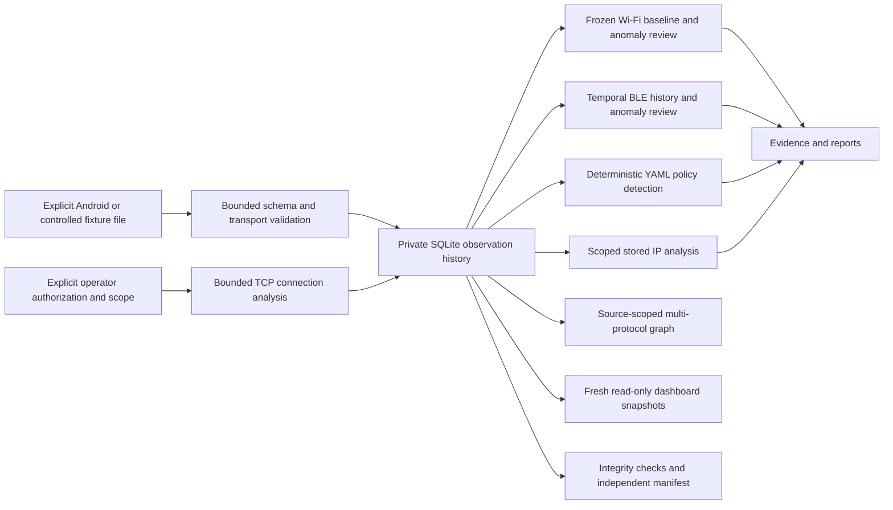

# ATLAS RF prototype architecture

The prototype is a synchronous local application for an ordinary Debian ARM64 user. Python owns orchestration, schema validation, bounded SQLite history, explainable rules, reporting and the terminal UI. PyYAML is the sole non-standard runtime dependency. Android radio APIs belong to a separate foreground Kotlin collector whose source is provided but whose APK/hardware behavior has not been verified here.

## Entry point and composition

`atlas/cli.py` contains the single dispatcher. The installed `atlas` command and source `scripts/atlas` use it. `atlas_rf/cli.py` translates old `import` to `ingest` and `probe` to `ip probe`, then delegates to the same dispatcher; it no longer maintains a parallel command implementation. Existing `atlas_rf` analysis/model/store imports remain compatibility re-exports.

| Module | Responsibility |
| --- | --- |
| `atlas/core` | Strict configuration/events, privilege checks, resource snapshots/budgets, structured logs, capability diagnostics, required child isolation |
| `atlas/bridge` | Bounded finalized export verification/import and transport-nonce inspection |
| `atlas/storage` | Private SQLite writer, bounded generic ingestion, separate read-only snapshot reader |
| `atlas/wifi` | Explicit discovery ingestion, immutable reviewed baselines, freshness-aware comparison |
| `atlas/cellular` | Authenticated export verification, bounded cellular schema/history, deterministic descriptive rules, reviewed baselines and scoped Android test requests |
| `atlas/bluetooth` | Discovery/GATT metadata ingestion, passive history, temporal comparison and explicit GATT request files |
| `atlas/detection` | Fixed policy predicates, thresholds, age windows, evidence IDs and persisted replay/cooldown handling |
| `atlas/network` | Literal bounded scope validation, read-only IP evidence analysis and explicit authorized TCP connects |
| `atlas/topology` | Multi-protocol observation graph and bounded low-confidence literal address matches |
| `atlas/reporting` | Legacy heuristics plus retained baseline/BLE/policy evidence and topology in one report |
| `atlas/ui` | Safe JSON/Markdown output and read-only curses/plain dashboard |
| `atlas/demo.py` | Controlled workflow, labelled scoring and measured synthetic resource workload |
| `atlas/fixtures/prototype.json` | Packaged invented observations, policy and reviewed expectation labels |
| `android/collector` | Foreground optional Wi-Fi/BLE/cellular session, confirmed metadata-only GATT source and separate opt-in bound HTTPS tests |

The demo uses the same public module functions exposed by the CLI. Integration tests exercise the CLI itself, including a fresh-process demo and actual curses PTY. The validation harness is development tooling and invokes trusted test/application processes; it is not a collector/plugin execution path.

## Data and baseline semantics

An observation has a validated kind, source label, observed identifier and timezone-aware normalized timestamp. Wi-Fi/BLE metadata is bounded, optional when missing, and never synthesized into claimed measurements. Source labels and GATT attestations are untrusted supplied provenance. Unknown fields, coordinates, credential fields, invalid types/ranges, duplicate JSON keys, nonfinite data and oversized imports fail validation. JSONL writes are transactional and exact canonical fingerprints deduplicate replay.

SQLite schema version 1 retains `observations`; additive `wifi_baselines`, `ble_findings`, `detection_findings`, `cellular_baselines` and `cellular_sessions` tables retain derived snapshots. Canonical SHA-256 hashes are evidence identifiers, not identities or signatures. A reviewed Wi-Fi baseline freezes eligible fresh history; later imports do not retrain it. Cached/stale/unknown measurements remain in history but do not train/trigger Wi-Fi review. BLE uses prior source/address observations within its temporal comparison window; this is retained historical context, not a separately approved immutable BLE baseline. Address rotation never merges devices by name, payload or service UUID.

Declarative policy selects five fixed predicates, exact sources/assets, age windows, thresholds and cooldowns; arbitrary expressions, plugins and LLM scoring are unsupported. Preview evaluates candidates without writes. `--save` evaluates and stores findings atomically with saved-history suppression. Findings remain anomalies/review hints rather than confirmed security incidents.

Topology keeps addresses scoped to their supplied source, so identical addresses in different observation domains are not silently merged. Radio, service, neighbor and route edges represent their particular evidence. A neighbor MAC equal to a Wi-Fi BSSID adds a low-confidence `address-equality-unverified` hint, capped at 4096 such edges. This does not authenticate device identity, infer BLE/Wi-Fi physical linkage, or prove co-observed devices communicate. The controlled graph demonstrates all protocols together, not an inferred physical topology.

## Read and write boundaries

Default database: `$XDG_DATA_HOME/atlas-rf/atlas.sqlite3`, otherwise `~/.local/share/atlas-rf/atlas.sqlite3`. YAML can select a path and CLI `--db` overrides it. Database parents must be owned and not group/world writable; files are regular, single-link, no-follow and mode 0600. Use trusted private ancestors. Newly created data directories use 0700. Reports/manifests use exclusive private creation and never overwrite.

Status, history, reports, topology, passive IP/BLE analysis, verification and retention preview open existing SQLite with `mode=ro`, `query_only`, `trusted_schema=OFF` and a consistent read transaction. Dashboard releases that transaction after building each frame and opens another on refresh, allowing newly committed events to appear without a long-lived read lock. Findings view includes saved BLE/policy findings alongside basic heuristics. It is a bounded latest-2000 view, not a complete evidence browser; retained finding display caps each table at 100, 64 KiB per record and 2 MiB total. Reports cap retained evidence at 100 rows/table, 1 MiB/record and 4 MiB total and expose explicit count/truncation. Dedicated evidence commands retrieve omitted records.

Imports, baseline creation, explicit `--save`, authorized probes, new output files and explicit deletion write. Optional configured command logs write metadata even for read commands. `storage.retention_days` defaults to 7 (1..3650); maintenance preview is read-only, `--apply` deletes within a transaction and compacts SQLite. Removing raw observations invalidates all derived copies and suppression state. No automatic retention daemon exists; exports/logs/backups require separate lifecycle management.

Verification checks SQLite, observation and finding hashes, supporting evidence, and a logical digest over all recognized evidence tables. An independently retained manifest detects additions/removal/changes. This does not authenticate a sender or protect against an attacker replacing both evidence and manifest. Cellular HMAC bridge keys are generated/imported explicitly and kept in private Debian files and Android app-private preferences; observations and these private keys have no application-level at-rest encryption. No SIM authentication material is accessed.

## Privilege, network and subprocess boundaries

Both CLI spellings refuse root, setuid/setgid and effective Linux capabilities and require `no_new_privs`. The main Python interpreter retains ordinary operator filesystem authority. IP probing uses main-process asyncio sockets only after explicit `--authorized` and literal scope. It is not Bubblewrap-isolated. Read-only IP analysis operates only on supplied stored evidence and opens no socket.

Compatible external utilities require the strict offline Bubblewrap profile: private namespaces, disabled nested user namespaces, cleared environment, closed inherited descriptors, dropped capabilities, read-only runtime/root, private bounded `/tmp`, parent-death cleanup and resource limits. There is no unsandboxed/shared-network fallback. User/combined namespace tests succeed here, but full setup fails because required NETLINK_ROUTE socket creation is denied. Host-network/D-Bus-dependent guest collectors and host netlink diagnostics are disabled. A tool-presence or whole-root-bind test is not a successful security-profile test.

Android source requests no permissions or collection on startup. Wi-Fi is off by default; optional Wi-Fi scan/location grants are separated from BLE/controller grants. BLE declares `neverForLocation`; no coordinate API or schema exists. GATT requires an expiring exact-address request, visible confirmation and an already-bonded target, with no pairing or value read/write operations. INTERNET and CHANGE_NETWORK_STATE are declared for separately authorized Android-bound HTTPS tests; no background-location or broad-storage permission is declared. Private cache cleanup is session-triggered and best-effort, not idle-time expiry; failed filesystem deletion can exceed the intended cache bound; exports use the selected document provider, whose own sync policy is outside ATLAS.

## Resources, operation and limitations

Imports are capped at 16 KiB/event, 32 MiB and 50,000 rows, with tighter bridge/radio-file limits. Observations cap at 200,000 and SQLite pages at 256 MiB. Reports/history/detection are bounded and indicate truncation or fail when a hard budget is exceeded. Child limits cap wall time, CPU time, address space, descriptor/process counts and output sizes. Monitor checks RSS/VM memory/disk reserves cooperatively; there is no aggregate cgroup or hard main-interpreter memory limit. TCP limits are 256 hosts, 32 ports, 32 workers and 0.05..5 second connection timeout. Logs rotate at 1 MiB plus two backups.

`atlas demo` creates a new private directory and separate demo/benchmark databases; `--db` is rejected to prevent mixing fixture data with user storage. Its final benchmark fast-forwards one simulated second per normal event and evaluates a rolling ten-minute window; final 100 events are individually timed after warm-up. It measures local execution, not RF packet timing or sustained battery impact. The earlier dense-history stress run and tail latency remain disclosed in [test-results.md](test-results.md).

Commands emit JSON stdout except explicit Markdown/plain terminal views; stderr logs encode command metadata without imported payloads. Exit codes: 0 success, 1 unexpected failure, 2 input/platform/permission/storage error (including unavailable isolation), 3 resource threshold, 130 interruption. No inbound service, background scanner, raw socket, Rust extension, cloud backend or geographic localization is implemented. See [test-results.md](test-results.md) for demonstrated versus unsupported capabilities and [threat-model.md](threat-model.md) for trust assumptions.

## Completion evidence

The 2026-10-29 completion run is retained in `artifacts/completion-20261029`; validation and the actual curses PTY capture are in `artifacts/completion-validation-20261029`. Both CLI spellings share the dispatcher. The demo uses production ingestion, baseline, detection, graph, report and verification modules; its IP analysis consumes explicitly scoped stored fixtures and performs zero network connections. The separate resource database records 10,000 normal synthetic events. Full methods and measured results appear in [test-results.md](test-results.md).

Configuration and policy inputs use bounded nonblocking regular-file reads with symlink refusal. Optional log files require an owned single-link regular file under an owned protected parent, including after rotation. Log rotation assumes one independent process writer and trusted ancestor directories.

## Cellular composition and trust boundaries

The [cellular module](docs/cellular.md) extends the common `kind=cellular` event pipeline rather than adding a second database or listener. `CellularCollector.kt` binds ordinary public TelephonyManager callbacks per active subscription; cell, signal, registration, data RAT/display and ConnectivityManager events remain distinct. RadioSession retains the bounded queue/spool, fixed clock conversion and finalized-file lifecycle. `BridgeAuthentication.kt` signs exact serialized envelope bytes with a separate transport key and challenge; Debian authenticates before the existing envelope/schema validation and transactional import. There is no Android/VM socket bridge.

SQLite retains canonical observations plus `cellular_sessions` availability/drop/clock metadata and explicit immutable `cellular_baselines`. Analysis never crosses source/session/subscription and keeps RAT/serving roles distinct. Only eligible recent modem-time cell observations drive serving/trend rules. Generic reports include cellular JSON/Markdown summaries; the topology records reported serving/neighbor identities without asserting tower authenticity; dashboard key `5` and `--protocol cellular` filter the same stored events. The existing retention and evidence verifier recognize the additional tables, including cellular derived-record hashes.

`BoundedNetworkTest.kt` is a separate explicitly authorized foreground workflow. It requests a verified Wi-Fi or cellular non-VPN Network, then uses `Network.openConnection` for one bounded HTTPS GET per transport. It never changes process-wide binding, uses a default network fallback or substitutes Debian networking. Success/failure/unavailability records are signed/exported using the same bridge. Device traffic/binding is not demonstrated. No changes to raw modem, SIM authentication, root access, Android security settings or VM networking are required.

The new Android source has not compiled here; pinned compile/target SDK 35 does not constitute Android 17 compatibility proof. The actual phone-to-VM authenticated challenge, permission behavior, cell availability and transport-specific traffic are outstanding device acceptance checks. Local protocol tests and synthetic analysis do not satisfy them.
