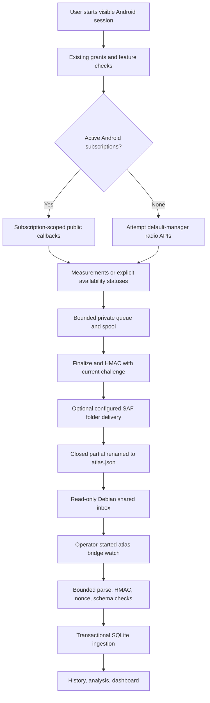

# Cellular pipeline repair — 2026-10-29

Read [the diagnosis recorded before implementation](cellular-pipeline-diagnosis-20261029.md) first. The SIM is deliberately paused. No SIM activation, mobile-data enablement, radio/location/security settings changes or bound HTTPS tests were performed or requested.

## Result and remaining boundary

Automatic file delivery and authenticated ingestion are now implemented around the native Android collector. Debian intake is covered by local synthetic protocol tests. Native changes remain source-only: no JDK/Gradle/SDK/APK is available here and no Android-produced export has been demonstrated. **The phone is not collecting automatically yet. Hardware integration remains incomplete.** These changes remove manual export/import from configured, explicitly started sessions; they do not introduce continuous/background collection, radio control or a working installation path.



Build/install, trusted pairing and actual SAF-to-virtiofs mapping are still required before this pipeline can run on the handset. No other Android scanner is required by the architecture. nRF Connect exports are not directly supported.

## Native changes

- `CellularTargets.select` preserves up to eight distinct nonnegative real subscription IDs; an empty list selects the default TelephonyManager, represented internally by null, never ID zero or a fabricated SIM.
- `CellularCollector` attempts its public callbacks/cell reads for that default target and records `none_active_not_a_software_failure`. The modem/API may still return no cells, cached measurements, unsupported APIs or unavailable subscription errors. A carrier-paused SIM can remain in Android's active list; no subscription-count heuristic establishes whether service is paid/paused.
- Default-manager telephony rows carry `subscription_scope: default_radio` and omit `subscription_id`. They cannot claim subscription events. Debian accepts and preserves them, but excludes unattributed cell observations from subscribed serving-cell comparisons and baseline training. No forced reactivation, modem commands or SIM-management APIs were added.
- Binding generations suppress late callbacks after rebinding or stop. Existing state/cell permission checks, timestamps and resource caps remain.
- MainActivity offers an optional **Choose automatic delivery folder** control and a disable control. An explicit Storage Access Framework grant selects a local directory once. After an explicitly started session finalizes, DirectoryDelivery writes an authenticated envelope to a unique `.partial`, closes it and requests rename to `.atlas.json`. No network listener, broad storage permission, foreground service or repeated auto-start is added.
- Provider permission loss, unsupported rename or output failure is reported separately from session finalization. The private finalized file remains available for manual export. Provider visibility/rename and Android 17 behavior must be device-tested. Changing/deleting a directory can invalidate the saved grant.

Storage API reference: [Android document access](https://developer.android.com/training/data-storage/shared/documents-files). Telephony API reference: [TelephonyManager](https://developer.android.com/reference/android/telephony/TelephonyManager). Default-manager calls use Android's default scope; they do not guarantee radio access with no active subscription.

## Debian intake

`atlas bridge watch` is a foreground command, started by the operator. It polls the configured inbox every `monitor.interval_seconds` (default two seconds) and stops with Ctrl-C/SIGTERM. It does not start Android, collect radios, change settings or create files in the share. It can run in one terminal while the dashboard reads the same private database in another.

After a collector is installed and privately paired, choose a local Android directory that is actually visible under `/mnt/shared`. Configure automatic folder delivery in the app, import the current key/challenge using the existing trusted provisioning workflow, then run:

```sh
atlas bridge watch --key PRIVATE_KEY_FILE --nonce EXPECTED_CHALLENGE
```

The default inbox is `/mnt/shared/Documents/ATLAS-RF`; override with `--inbox ACTUAL_LOCAL_SHARE_DIRECTORY`. Global `--db PRIVATE_DB` selects a database. Add `--once` for one pass; it returns exit 2 if files were rejected or the inbox is unavailable/over limit. These are placeholders, not working phone pairing credentials. There is currently no Android-exported file to ingest.

Only regular `.atlas.json` files are considered; symlinks are rejected. Each pass refuses more than 1,024 directory entries instead of silently truncating. Per-file existing limits remain 16 MiB outer/8 MiB payload/10,000 events. Reads are nonblocking and bounded; authentication/challenge/schema checks complete before storage opens. Changed partial files are retried. Unchanged versions are remembered in bounded process memory; restarting the watcher safely re-verifies files and SQLite deduplicates identical records/session metadata. The watcher writes no acknowledgment/deletion into the read-only share.

The consumer requires authenticated non-synthetic envelopes even for zero-row sessions. It intentionally offers no unsigned/synthetic fallback. Locally generated tests with Android-format labels exercise that contract and are explicitly not hardware evidence. HMAC proves possession of the shared secret, not Android or modem attestation. The challenge is operator-managed and not consumed or expired automatically; rotate for a new assessment.

## Failure separation

| Layer | Output/evidence | Meaning |
| --- | --- | --- |
| Implementation/deployment | `companion_implementation: KOTLIN_SOURCE_ONLY`, `companion_deployment: UNVERIFIED` | Source exists; APK/device behavior has not been established |
| Permission/API | Android session statuses: phone-state required, precise location unavailable, SecurityException, unsupported | Required existing grant/API not available; no settings changes to compensate |
| Measurement | `none_active_not_a_software_failure`, empty/cached/no-service statuses, zero `measurement_rows` | May be expected with paused/no SIM; not proof of broken transport |
| Transport | `INBOX_UNAVAILABLE`, `INBOX_LIMIT_EXCEEDED`, `EXPORT_READ_FAILED`, app delivery failure | Directory/provider/access problem, separate from radio state |
| Authentication | `AUTHENTICATION_FAILED` | HMAC/challenge mismatch or invalid authenticated wrapper; no import |
| Validation | `INVALID_EXPORT` | Partial/schema/checksum/provenance failure; no import |
| Intake | `AUTHENTICATED_EXPORT_INGESTED`, inserted count, measurement row count | Accepted evidence, not hardware completion |

`measurement_rows` counts accepted LTE/NR cell/signal rows with an actual identity or metric field. It does not mean new insertions or fresh measurements; inspect freshness, timestamps and duplicates separately. Status-only sessions are retained in `cellular_sessions`, with zero measurements. Watcher summaries always retain `hardware_access: UNVERIFIED`.

The historical `companion_implemented` status field remains false for compatibility with callers that treated it as verified deployment. New explicit source/deployment fields remove that ambiguity. A `cellular: disabled_by_default` status by itself no longer incorrectly makes a Wi-Fi/BLE-only export require cellular authentication; failed/empty actual cellular sessions still require authentication.

## Validation and acceptance

Python regression tests cover default scope without a subscription ID, rejection of contradictory/missing scope, conservative baseline eligibility, status-only import, wrong challenge/HMAC, malformed and changed partial files, symlinks/synthetic refusal, directory bounds, share immutability, CLI one-pass intake and idempotent ingestion. Existing tests are preserved. **Actual result: 225 tests run, 224 passed, one existing socket-dependent skip; real PTY dashboard views passed and the database was unchanged.** Results are in `artifacts/cellular-pipeline-validation-20261029/validation.json`.

New Kotlin `CellularTargetsTest` covers empty lists, invalid IDs, actual subscription zero, deduplication and target bounds. It has not executed here. Gradle/JVM tests/lint/APK assembly, SAF grant/revoke/rename tests, lifecycle/rebinding tests and actual phone-to-Debian ingestion remain required on an equipped build/device path.

Keep the SIM paused during validation. A genuine status-only Android export can establish the bridge even if no radio measurements are available. Record bridge delivery separately from LTE/NR measurement acceptance; do not mark the latter complete without genuine Android-produced LTE/NR observations verified and ingested. The next necessary step remains building/deploying the app through an approved path, not changing SIM service.
