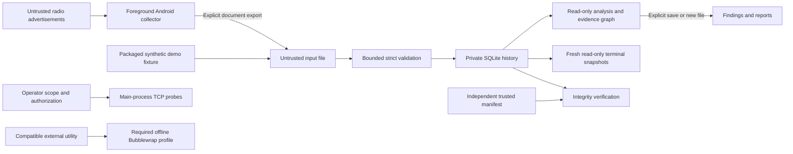

# ATLAS RF prototype threat model

## Overview

ATLAS RF is an ordinary-user local observation-analysis prototype. The user-provided target is a Pixel 10 Pro XL, Android 17, native Debian ARM64 Linux VM and approximately 6 GiB VM RAM. Recorded execution establishes an aarch64 Android-kernel Linux host, not handset identity or working Android radio APIs. All completed discovery/GATT/IP demo data is explicitly synthetic. See test-results.md for measured capabilities.

An independent read-only reviewer inspected both the original architecture and the earlier integrated prototype. The later cellular extension has not received that independent review. Material claims were checked against their actual consumers. This is a source-backed threat model, not an exhaustive vulnerability audit or a claim of deployed hardware security.

| Component | Role and source |
| --- | --- |
| Single CLI | atlas/cli.py defines commands; atlas/cli.py dispatches. atlas_rf/cli.py:11 translates legacy spelling and delegates. |
| Observation boundary | atlas/core/events.py validates; atlas/bridge/bundle.py reads bounded regular files; atlas/storage/ingest.py validates generic imports before storage. |
| Local evidence | atlas/storage/sqlite.py creates private bounded storage; atlas/storage/reader.py opens read-only snapshots. |
| Analysis | atlas/wifi/intelligence.py freezes baselines; atlas/detection/engine.py saves policy evidence; atlas/network/analysis.py analyzes supplied scoped records. |
| Multi-protocol graph/UI | atlas/topology/graph.py preserves evidence relations; atlas/ui/dashboard.py opens fresh snapshots; atlas/ui/dashboard.py drives curses. |
| Isolation | atlas/core/isolation.py constructs required offline Bubblewrap arguments; atlas/core/isolation.py refuses incompatible execution. |
| Controlled demonstration | atlas/demo.py composes ingestion, baselines, detection, IP analysis, graph, dashboard/evidence and resource measurement. |

| Deployment or workflow | Resource or capability | Configuration and precedence | Safe effective value or location | Readers, writers, or recipients | Enforcing control | Evidence or unknowns |
| --- | --- | --- | --- | --- | --- | --- |
| Canonical CLI and alias | SQLite observations/derived data | XDG default, then YAML, then --db | XDG_DATA_HOME/atlas-rf/atlas.sqlite3 or ~/.local/share/atlas-rf/atlas.sqlite3 | Ordinary operator account | Owned non-writable parent, regular single-link/no-follow database, 0600, transactional validated inserts | atlas/core/config.py; atlas/cli.py; atlas/storage/sqlite.py. Trusted ancestors and same-account integrity remain assumptions. |
| Read-only commands | Existing database | Command-selected configured path | Existing SQLite file | Analysis/display process | mode=ro, query_only, trusted_schema=OFF, transaction | atlas/storage/reader.py. Explicit optional command logs can still write metadata. |
| Dashboard | Latest history and saved evidence | Existing --db; selected view; refresh every two seconds | At most 2000 observations and 100 saved records/table in findings mode | Terminal user | Fresh closed transaction per frame, sanitized text, no collection | atlas/ui/dashboard.py and :42. Actual curses PTY exit and unchanged DB were demonstrated. |
| Demo | Separate synthetic databases and files | Required new output directory; global --db rejected | OUTPUT/demo.sqlite3 and OUTPUT/resource-benchmark.sqlite3 | Local operator | Exclusive directory creation/private output; synthetic label; no sockets/radios | atlas/demo.py; atlas/cli.py. Main demo retains ordinary operator authority. |
| Android spool/export | Sensitive observations | cacheDir/atlas-radio/session UUID; explicit chosen document URI | App-private cache and selected provider | App UID; provider/export recipients | Bounded queue/count/bytes/time, session-triggered cleanup, explicitly scoped opt-in HTTPS tests; INTERNET declared | Android MainActivity.kt and RadioSession.kt under android/collector/app/src/main/java/org/atlasrf/collector. Provider sync and Android runtime remain unverified. |
| Authorized TCP | Outbound connections | --authorized plus literal bounded scope/ports | At most 256 hosts, 32 ports, 32 workers | Selected endpoints | Input bounds and explicit operator attestation | atlas/network/collector.py and :44; atlas/cli.py. Runs in main process, not Bubblewrap. |
| Compatible utility | Child filesystem/network authority | Fixed offline profile | Read-only system runtime/root; private 16 MiB tmp; hidden home/shared storage/bus | Trusted system utility | Required namespaces, disabled nested user namespaces, zero capabilities, no_new_privs, clean environment/fds, time/resource limits | atlas/core/isolation.py, :37, :65, :78. Setup fails here at NETLINK_ROUTE; no fallback. |
| Logging/reports | Metadata and potentially sensitive evidence | stderr default; optional logging.file or new output file | Operator-selected destination | Terminal, log/report recipients | ASCII JSON, private no-follow rotation, exclusive private report creation | atlas/core/logging.py; atlas/ui/console.py. Shell redirection/backups/providers are external responsibilities. |

## Threat Model, Trust Boundaries, and Assumptions

Assets are sensitive radio/network identifiers, source UUIDs, names, payloads, timestamps and inferred proximity relationships; observation/evidence completeness and integrity; constrained guest resources; and the operator's ordinary filesystem/network authority.

Nearby transmitters may control advertisement contents, addresses, names, RSSI conditions and timing. File suppliers may forge any self-consistent observation, source label, checksum or authorization attestation that an operator imports. Endpoint operators control connection responses. Other local users may read improperly shared exports but are not assumed to control the private data directory. Root, a compromised runtime/OS, or another process controlling the same account exceeds protections based on file modes and unkeyed hashes.

Boundary crossings are radio-to-platform callback, document provider/file-to-parser, event-to-SQLite, database-to-report/terminal, operator attestation-to-network/GATT operation, and application-to-utility. There is no inbound API, credential service, dynamic executable plugin loader, cloud backend, automatic collection or incident-promotion capability.

The CLI refuses root, setuid/setgid and effective capabilities and requires no_new_privs (atlas/core/privilege.py; atlas/cli.py). This limits elevation but does not sandbox the main interpreter, parsers, database operations, demo or authorized asyncio sockets. The utility isolation profile is a distinct, fail-closed boundary. Development validation may invoke the trusted application/test interpreter and PTY driver; it is not an untrusted-collector execution service.

No coordinate fields or location API are used. Android Wi-Fi inclusion defaults off and requires an explicit selection; its optional location grant is separate from BLE/controller grants. BLE declares neverForLocation. Optional Wi-Fi scanning still needs declared coarse/fine location permissions under Android's API requirements; those grants may persist in the OS. INTERNET and CHANGE_NETWORK_STATE support explicit bound HTTPS tests; no background location/broad-storage/advertising permissions are declared (android/collector/app/src/main/AndroidManifest.xml:1). Cellular export authentication introduces a separately paired HMAC key in private Debian files and app-private Android preferences. It is transport authentication material, not a SIM key. Sensor/request UUIDs remain identifiers, not authentication.

Source/address scoping avoids silently merging radios/networks. A neighbor MAC equal to a Wi-Fi BSSID yields a bounded, low-confidence address-equality-unverified hint, not authenticated device identity or connectivity. Names/payloads/UUIDs never merge BLE and Wi-Fi identities (atlas/topology/graph.py and :41). Spoofing, address reuse, stale evidence and unauthenticated sources constrain even these literal matches.

SQLite/bundle SHA-256 detects damage/internal inconsistency; it does not prove origin, actual radio capture or authorization. The logical evidence manifest covers recognized table schemas/rows and detects additions/removal/changes only when retained independently (atlas/security/evidence.py and :71). A writer replacing both evidence and manifest can recompute everything. Baselines lack a standalone authenticated content hash.

Retention defaults to seven days but is explicit maintenance. Raw expiry invalidates all derived baselines/findings because they can embed expired observations; suppression state and newer derived evidence are sacrificed too (atlas/security/retention.py; atlas/storage/sqlite.py). Android cleanup runs when a session starts. Exports, logs, manifests, backups, terminal scrollback, snapshots and physical flash remnants have separate lifetimes. At-rest observations are plaintext; encrypted device/volume storage and trusted output recipients are deployment assumptions.

Actual capability checks found no exposed guest Wi-Fi/BLE adapters, denied TCP socket creation, and a read-only shared mount. User/combined required namespaces work, but Bubblewrap 0.12.0 cannot complete the exact profile because a required NETLINK_ROUTE socket is denied. Payload assertions cannot therefore be claimed to have run successfully. Host-network/D-Bus collectors are disabled. No security restriction was bypassed.

## Attack Surface, Mitigations, and Attacker Stories

These are threat scenarios and design limitations, not validated new vulnerability findings.

| Priority | Scenario and capability gain | Prerequisites | Impact | Existing controls | Mitigation | Evidence |
| --- | --- | --- | --- | --- | --- | --- |
| High | Host execution or resource exhaustion through hostile import or displayed metadata | Operator admits attacker-controlled observations | Local execution, memory/disk/CPU pressure or terminal deception if controls fail | No shell/eval/object YAML/plugin loading; strict bounded contracts; parameterized inserts; escaped output | Preserve validation/resource regressions; trust and maintain Python/SQLite/PyYAML/runtime packages | atlas/core/events.py; atlas/storage/ingest.py; atlas/storage/sqlite.py; tests/test_security.py |
| High | Isolation failure silently exposes host files/network to a utility | Incompatible namespace/kernel policy or missing bwrap feature | Child gains ordinary host authority | Exact required offline profile, no fallback, incompatible host collectors refused | Keep refusal; rerun profile tests per deployment; do not use whole-root-bind success as proof | atlas/core/isolation.py, :78, :95 |
| High | Forged or incomplete evidence produces misleading review conclusions | Import supplier or writer to local evidence | Incorrect investigation, hidden history or false provenance | Internal hashes, consistent read snapshots, independent manifest comparison, explicit authenticity caveats | Independently protect manifests; add authenticated sensor/signature design if operational needs demand it | atlas/bridge/bundle.py; atlas/security/evidence.py and :71 |
| Medium | Sensitive identifiers outlive retention through findings, baselines or exports | Real observations and saved analysis/output | Proximity/location inference or unauthorized disclosure | Private modes; raw expiry invalidates all derived tables; no coordinates | Schedule explicit retention; encrypt storage and manage outputs/backups separately | atlas/security/retention.py; docs/security.md |
| Medium | Untrusted pathname/link redirects writes | Writable ancestor or same-account interference | File modification/disclosure | Owned parent, no-follow/single-link checks, exclusive output | Keep private trusted ancestors; do not infer same-account isolation | atlas/storage/sqlite.py; atlas/ui/console.py |
| Medium | Scoped IP/GATT operation reaches unintended endpoint | Explicit active workflow or supplied request | Unauthorized traffic or privacy disclosure | Literal scope/authorization flag; GATT exact address, expiry, confirmation and bonded-only metadata discovery | Independently verify authorization and actual device behavior; never call imports proof of real operation | atlas/network/collector.py and :44; Android GattInspector.kt and MainActivity.kt |
| Medium | Cross-protocol graph is mistaken for authenticated physical topology | Spoofed/reused addresses or misunderstanding of graph | Misattribution between networks/devices | Source-scoped nodes, explicit low-confidence equality edges, no BLE identity merging | Preserve edge caveats; use authenticated external evidence for attribution | atlas/topology/graph.py and :41 |
| Medium | Repeated scans/imports/analysis exhaust the limited guest | Large admitted workload or invoked utility | Availability loss | Import/database/history/group/evidence limits; child quotas; bounded scratch; monitor thresholds | Host quotas and retention; no aggregate cgroup or real-time guarantee is implied | atlas/storage/sqlite.py and :60; atlas/core/isolation.py; atlas/demo.py |
| Low | OS permission or provider sync persists beyond a visible session | User previously granted permission or selected syncing provider | Additional privacy exposure | No automatic collection, optional Wi-Fi, network traffic only after explicit endpoint authorization, bounded cache, FLAG_SECURE | Revoke unused grants and use trusted local providers; delete exported copies separately | android/collector/app/src/main/AndroidManifest.xml:1; Android MainActivity.kt |

Unknowns remain Android compilation/install, runtime permission/lifecycle behavior, actual Wi-Fi/BLE capture, live GATT, device battery/thermal impact, RF arrival/queue loss, LAN reachability and full offline isolation on another guest. The controlled suite demonstrates 55 imported records, nine Wi-Fi/four BLE/five policy findings, a 10,000-normal-event benchmark and actual terminal rendering. Its 20 labelled policy decisions are not field accuracy, statistical generalization or proof of attack detection. The earlier dense-history benchmark missed its latency target and is retained in test-results.md rather than hidden.

Retained report output is additionally bounded to 1 MiB per record and 4 MiB total; dashboard saved findings to 64 KiB per record and 2 MiB total, with explicit truncation. The final standard-library suite executes every discovered workflow: 183 tests, 182 passed and one real-TCP test skipped because socket creation is denied. PTY validation is separate and passed. No custom seccomp policy, aggregate cgroup quota, encrypted database, authenticated source transport, geographic localization or physical-device identity mechanism is implemented. Subprocess pre-exec handling assumes synchronous use, not multithreaded embedding. Same-account compromise and trusted runtime tree replacement remain out of scope.

## Severity Calibration (Critical, High, Medium, Low)

Critical would require a demonstrated privilege escalation or broad remote compromise beyond the operator boundary. Neither source-label forgery nor controlled fixture matches establish that capability.

High can apply to a verified attacker-input-to-host-execution path or a real sandbox bypass exposing private operator data. Refusing execution when isolation is unavailable is an availability limitation, not such a bypass. An attacker already controlling root or the same account does not gain a new privilege merely by changing that account's files.

Medium can apply to reachable cross-principal observation disclosure, active traffic outside approved scope, retained sensitive copies surviving required deletion, meaningful graph misattribution without its required caveats, or realistic guest denial of service. Severity depends on actual exposure and workflow, not invented remote tenancy.

Low covers limited metadata exposure or misleading hints with constrained consequences. Mesh BSSID changes, address rotation, cache differences and unauthenticated self-consistent imports are not confirmed incidents. Confidence and missing hardware proof remain separate from impact.

## Hardening revalidation, 2026-10-29

A fresh source-only architecture review independently traced the CLI, Android, storage, evidence, retention, utility and active-network boundaries. The parent checked the file input and event-log consumers and reran the security and full application suites. No exhaustive audit or successful Android runtime validation is claimed.

Configuration and policy paths now share the bounded, nonblocking regular-file reader, refusing symlinks and special files before parsing (atlas/core/config.py; atlas/detection/policy.py; atlas/bridge/bundle.py). This closes a reproduced FIFO stall in both YAML loaders while retaining strict parsing and the 64 KiB ceiling. Missing/invalid configuration fails without exposing its contents. Symlink configurations must be replaced with an explicit regular-file path.

Optional logs now require an owned, regular single-link descriptor and an owned parent without group/world write access. File validation precedes chmod; opens use no-follow and nonblocking flags and checks repeat on rotation reopen (atlas/core/logging.py). Regressions reproduced hardlink/FIFO/shared-parent acceptance before the correction; tests/test_security_logging.py and tests/test_security_inputs.py now cover rejection and legitimate private rotation. Rotation assumes one independent process writer and trusted ancestors; it does not isolate a compromised operator account. Retained rotated logs remain outside age-based observation retention.

Fresh `atlas security isolation` returned exit 2 with user and required combined namespaces SUPPORTED, Bubblewrap profile UNSUPPORTED, usable false, and fallback refuse_execution. The exact profile again failed on denied NETLINK_ROUTE access before its payload assertions could run. This confirms safe refusal here, not successful payload isolation or suitability on another device. The full suite ran 183 tests: 182 passed, one socket-restricted real-TCP test skipped; the 34 security regression tests passed. These measured results apply to this source snapshot and execution environment.

Android cache cleanup is best-effort: filesystem deletion failures can leave older session spools despite the intended two-prior-session policy (android/collector/app/src/main/java/org/atlasrf/collector/RadioSession.kt:35). Cleanup occurs only on new-session creation; operators must also control exports, backups, providers and encrypted device storage. Android build/permission/radio/GATT behavior is still unverified. No precise coordinates or application credentials are introduced.

Completion revalidation: the 10,000-event controlled run at `artifacts/completion-20261029/results.json` passed the stated resource budgets with zero stored-event loss; `artifacts/completion-validation-20261029/validation.json` records 182 passing tests, one denied-socket skip, and successful real curses PTY interaction with unchanged evidence. Capability/isolation/manifest checks are retained beside the demo results. These synthetic outcomes do not prove live Wi-Fi/BLE/GATT, real TCP reachability, Android permissions or full Bubblewrap payload isolation. No code was committed or pushed.

The version below is a source snapshot of atlas, atlas_rf, android, config, scripts, tests and pyproject.toml, excluding bytecode/build caches; generated artifacts and root documentation are not included.

Repository: 7363ec19ec7bbe22ef6776d4970de8de1cc148bfacb1fb579c23b32201460435
Version: codex-security-snapshot/v1:sha256:6bb70fb75e986739bed6c9756ed70a8fb478a15e145517764f90bfa8e3994464

## Cellular extension threats and limits

The paired file bridge crosses untrusted document-provider/shared-storage boundaries. The 256-bit shared key must be provisioned through a trusted channel, retained under private owned paths/app storage with backup disabled, and removed from provider/transfer copies. Android Keystore wrapping is not implemented; app-private preferences and Debian key files have no application-level encryption. Compromise of the operator account, app UID, provisioning provider or key defeats sender authentication. HMAC authenticates exact bytes including metadata, not hardware readings, device identity, carrier identity or operator judgment. There is no confidentiality or nonrepudiation claim. Retain signed original exports separately from logical database manifests.

Expected per-assessment challenges bind exports to operator-selected nonce values; new challenges reject old exports. Reusing an expected challenge permits idempotent re-import (event and session metadata deduplication), not one-time replay consumption. A forged/replaced public challenge without the key can cause denial of service but cannot forge a matching signature. No Android-to-Debian transport has been demonstrated; shared-directory visibility and local synthetic authentication tests alone do not prove delivery.

Untrusted cell IDs, spoofable network metadata, missing/old samples, modem filtering, subscription ID reuse and legitimate handovers are uncertainty sources. Cached/unknown samples never train serving baselines or drive cell trends. Rules isolate observation scopes and gaps; reviewed baselines record history rather than trusted tower identities. Unfamiliar cells, signal changes and 5G fallback are never automatically classified as an IMSI-catcher attack. Cell/network identifiers still expose location context despite absence of coordinate collection. Full PS/CS/NAS registration and field false-positive rates remain unknown.

Optional INTERNET/CHANGE_NETWORK_STATE permissions expand the app's authority. The implementation accepts only explicitly confirmed, expiring HTTPS endpoint requests, no credentials/query/fragment/redirects, capped response reads and bounded network acquisition/operation/session lifetimes. Normal TLS validation remains enabled; tests transmit no cellular records or identifiers. Requests bind to Android Network objects after transport/VPN checks, with no unbound fallback. Routing changes, DNS/TLS/server latency, VPN or carrier policy and process death can prevent/interrupt tests. Bound network behavior, watchdog effectiveness and permission revocation need actual Android testing; canceled work may omit a result. No upload-speed, packet-RTT or per-SIM performance claim is supported.

The cellular event schema rejects IMSI, ICCID, IMEI, authentication-key and raw-modem-signaling fields. Public source code does not query them. No modem diagnostic interfaces, root or privileged APIs are used. Synthetic fixtures always carry explicit provenance; neither authenticated synthetic envelopes nor test-only signature vectors establish real hardware support.
